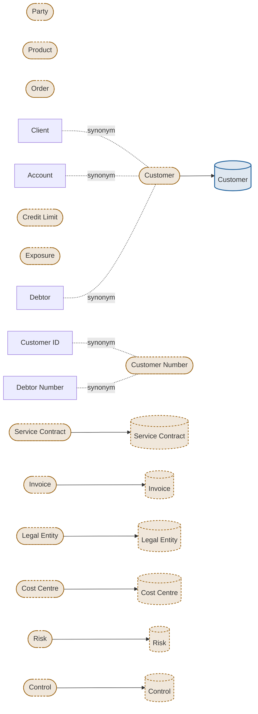
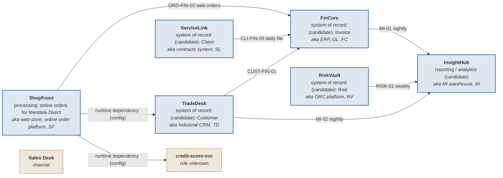
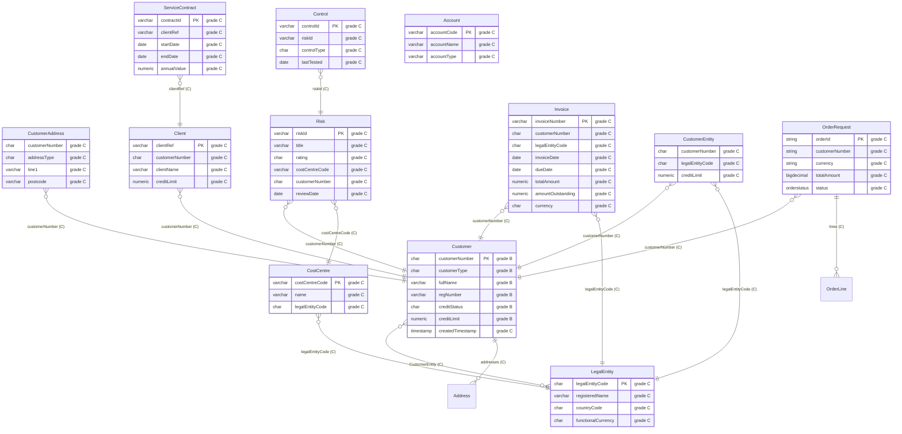
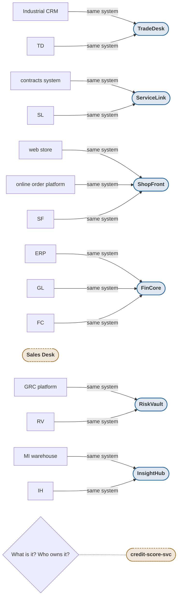
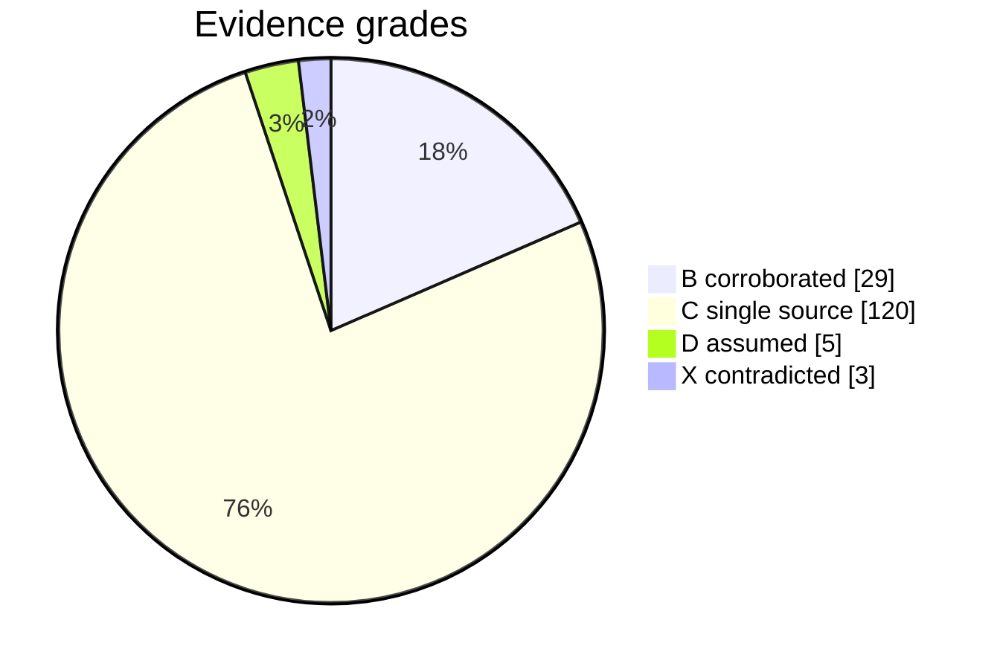
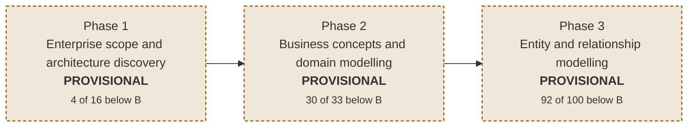

# Diagrams — loop-01

Generated from the graded model by `ontokit`, one set per agent. Node colours show evidence grade: A confirmed · B corroborated · C single source (dashed) · D assumed · X contradicted.

## Business Analyst · Concept map

Business terms by domain. Rounded boxes are concepts; dotted links are synonyms; arrows point to the entity that holds each concept. "(undefined)" marks a term used without a definition.

## Enterprise Architect · System context

Each system with its candidate role and known aliases, and the data flows between them, labelled with interface ids.

## Data Architect · Entity-relationship diagram

Entities with up to 8 attributes each (PK marks a key), and relationships with cardinality. Labels show how each link is made and its grade.

## Ontology Steward · Alias merges

System names merged only where a source states they are the same. A diamond marks a system nobody explains.

## Conformance · Evidence grades

How the evidence for every element is graded.

## Conformance · Phase gates

Automated exit-gate result per phase, with how much in-scope evidence is still below grade B.

