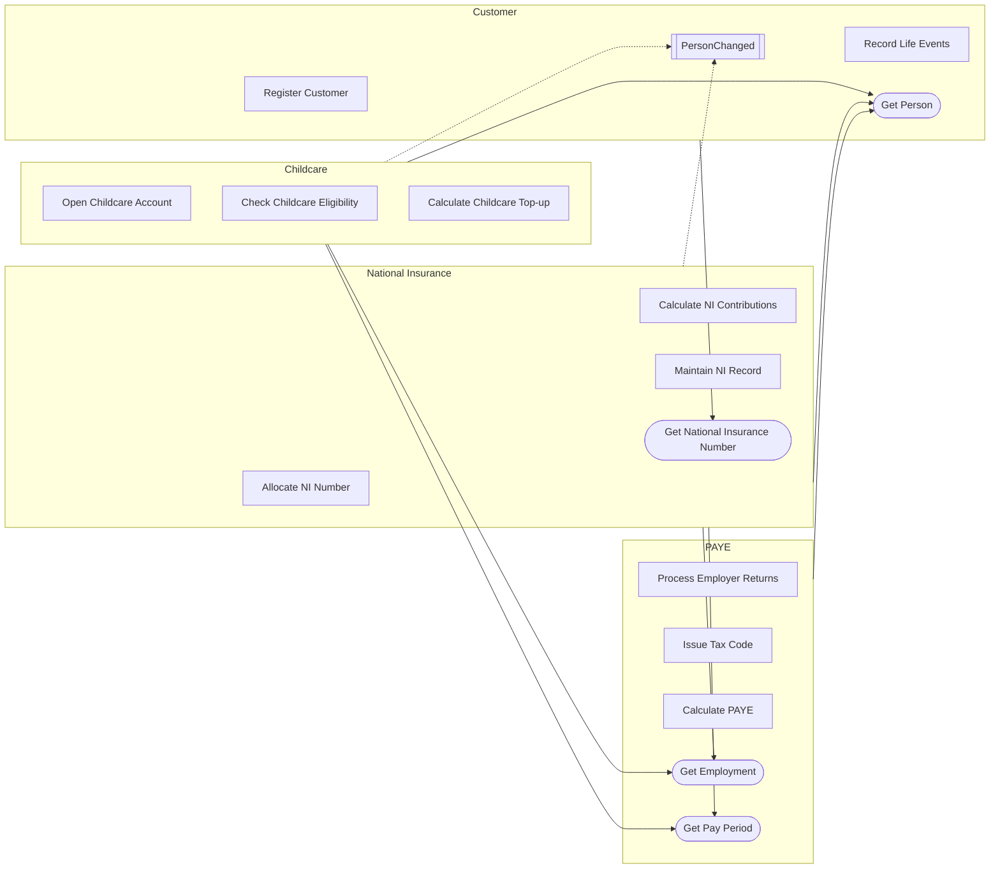

# Decomposition of TAXCORE — loop-01

Rule: the domain whose business capability creates or changes data owns it. Other domains use the owner's services or events.

| Domain | Owner | Entities | Attributes | Calculations | Capabilities | Services | Grades |
|---|---|---|---|---|---|---|---|
| **Customer** | Director of Customer Services | 2 | 10 | 2 | 2 | 4 | A:0 B:0 C:21 D:0 X:0 |
| **PAYE** | Director of Employer Taxes | 4 | 17 | 3 | 3 | 5 | A:0 B:0 C:40 D:0 X:1 |
| **National Insurance** | Director of National Insurance | 2 | 11 | 3 | 3 | 4 | A:0 B:0 C:27 D:0 X:2 |
| **Childcare** | Director of Family Support | 4 | 20 | 3 | 3 | 3 | A:0 B:1 C:47 D:0 X:0 |

## Target picture

## Entity ownership

| Entity | Monolith table | Domain | Basis | Grade |
|---|---|---|---|---|
| Person | TC_PERSON | Customer | changed by Customer, National Insurance; Customer creates it | C |
| Address | TC_ADDRESS | Customer | only Customer capabilities change it | C |
| Employer | TC_EMPLOYER | PAYE | no capability writes it; assigned by business vocabulary | C |
| Employment | TC_EMPLOYMENT | PAYE | only PAYE capabilities change it | C |
| TaxCode | TC_TAX_CODE | PAYE | only PAYE capabilities change it | C |
| PayPeriod | TC_PAY_PERIOD | PAYE | only PAYE capabilities change it | C |
| NiContribution | TC_NI_CONTRIBUTION | National Insurance | only National Insurance capabilities change it | C |
| NiRecord | TC_NI_RECORD | National Insurance | changed by National Insurance, Customer; National Insurance creates it | C |
| ChildcareAccount | TC_CHILDCARE_ACCOUNT | Childcare | changed by Childcare, Customer; Childcare creates it | C |
| Child | TC_CHILD | Childcare | only Childcare capabilities change it | C |
| ChildcarePayment | TC_CHILDCARE_PAYMENT | Childcare | only Childcare capabilities change it | C |
| EligibilityCheck | TC_ELIGIBILITY_CHECK | Childcare | only Childcare capabilities change it | C |

## Split candidates (columns that move to another domain)

- **Person.NI_NUMBER** → National Insurance: created by *Allocate NI Number* (PRC_ALLOCATE_NINO). Customer keeps a reference.

## Cross-domain writes → events

- **PersonChanged** published by Customer, consumed by National Insurance: replaces PRC_CLOSE_DECEASED (Record Life Events) changing NiRecord directly.
- **PersonChanged** published by Customer, consumed by Childcare: replaces PRC_CLOSE_DECEASED (Record Life Events) changing ChildcareAccount directly.

## Cross-domain dependencies → query services

| Consumer | Provider | Data | Today via |
|---|---|---|---|
| Childcare | Customer | Person | Child → Person (reference), ChildcareAccount → Person (reference), PRC_OPEN_CC_ACCOUNT |
| Childcare | PAYE | Employment, PayPeriod | PRC_CHECK_ELIGIBILITY |
| Customer | National Insurance | National Insurance Number | Person.NI_NUMBER (moved) |
| National Insurance | Customer | Person | NiRecord → Person (reference), PRC_ALLOCATE_NINO, PRC_CALC_NIC |
| National Insurance | PAYE | Employment, PayPeriod | NiContribution → Employment (reference), PRC_CALC_NIC |
| PAYE | Customer | Person | Employment → Person (reference) |

## Business services (access layer)

### Customer

| Service | Type | Used by | Replaces / implements |
|---|---|---|---|
| Register Customer | command | — | PRC_REGISTER_PERSON |
| Record Life Events | command | — | PRC_CLOSE_DECEASED |
| Get Person | query | Childcare, National Insurance, PAYE | — |
| PersonChanged | event | National Insurance, Childcare | PRC_CLOSE_DECEASED writing NiRecord, PRC_CLOSE_DECEASED writing ChildcareAccount |

### PAYE

| Service | Type | Used by | Replaces / implements |
|---|---|---|---|
| Process Employer Returns | command | — | PRC_LOAD_RETURNS |
| Issue Tax Code | command | — | PRC_ISSUE_TAX_CODE |
| Calculate PAYE | command | — | PRC_CALC_PAYE |
| Get Employment | query | Childcare, National Insurance | — |
| Get Pay Period | query | Childcare, National Insurance | — |

### National Insurance

| Service | Type | Used by | Replaces / implements |
|---|---|---|---|
| Allocate NI Number | command | — | PRC_ALLOCATE_NINO |
| Calculate NI Contributions | command | — | PRC_CALC_NIC |
| Maintain NI Record | command | — | PRC_UPDATE_NI_RECORD |
| Get National Insurance Number | query | Customer | — |

### Childcare

| Service | Type | Used by | Replaces / implements |
|---|---|---|---|
| Open Childcare Account | command | — | PRC_OPEN_CC_ACCOUNT |
| Check Childcare Eligibility | command | — | PRC_CHECK_ELIGIBILITY |
| Calculate Childcare Top-up | command | — | PRC_CALC_TOPUP |

Files: `domains/<domain>.yaml` (LinkML), `services/<domain>.openapi.yaml`, `source-to-target.csv`, `decomposition.json`.
